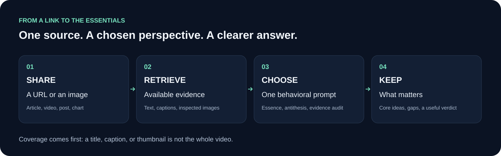
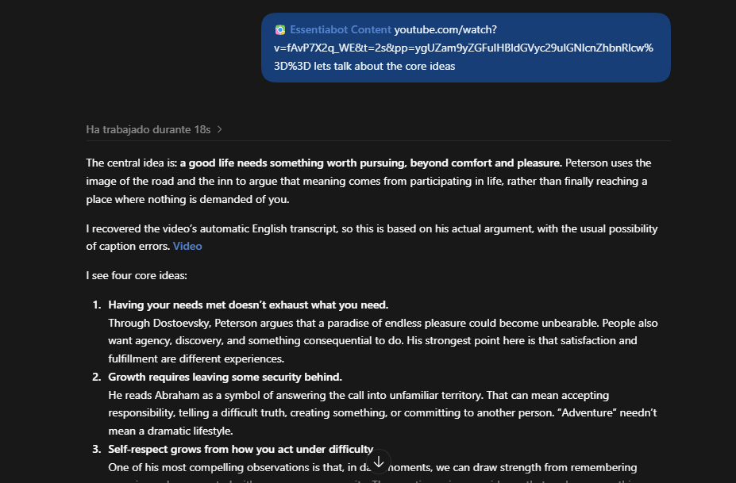
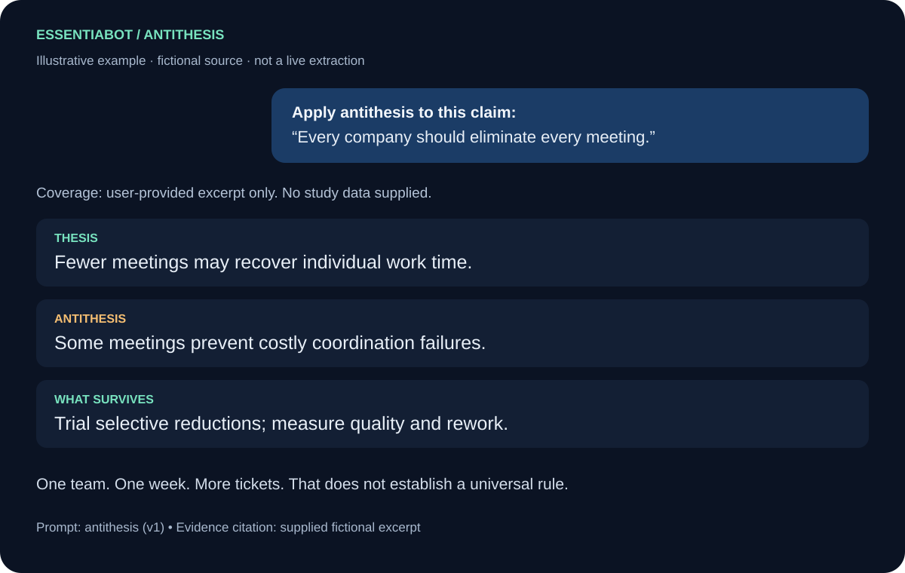

# Essentiabot Content

**Paste a URL. Choose a lens. Keep what matters.**


Essentiabot helps your chat retrieve the content available behind a link—page text, YouTube captions, social captions, or images—and examine it with a useful behavioral prompt. Get to the central idea, test the argument, and separate substance from repetition, promotion, and unsupported claims.

**[Get started](docs/INSTALLATION.md) · [Choose a prompt](skills/essentiabot-content/prompts/README.md) · [Copy-and-paste examples](docs/EXAMPLES.md) · [User manual](docs/USER_MANUAL.md)**

All instructions, prompts, and manuals are in English. Responses can be in the language you request.

## The simple workflow



1. **Share a URL or image** in a chat that has the skill installed, or use the manual prompt method below.
2. **Choose how to think about it:** essentials, antithesis, Socratic questions, evidence audit, technical tradeoffs, and more.
3. **Read the useful part:** what the source says, what supports it, what is uncertain, and what is worth keeping.

The assistant reports what it actually accessed. A transcript supports analysis of spoken claims; a thumbnail or title supports only a limited analysis of that preview. Downloading an image is followed by actual visual inspection when the host supports it.

## Copy this into chat

With Essentiabot installed and its files available, replace the final line with your source URL:

```text
Use Essentiabot Content. Load prompts/antithesis.md from the installed skill directory and apply it to the URL below.
Retrieve the available content first, including captions or relevant images when accessible. State exactly what you recovered.
Give me the strongest fair thesis, its strongest objection, an evidence test, and what survives. Remove filler and preserve important caveats. Keep it under 400 words.
Cite the template as "Prompt: antithesis (v1)" and cite the content source separately.
If you cannot read the prompt file, tell me so instead of claiming it was loaded.

Source: [paste URL here]
```

**No skill installation?** Open the [antithesis prompt](skills/essentiabot-content/prompts/antithesis.md), copy its complete code block into your chat, and add your URL. The [prompt guide](docs/PROMPT_GUIDE.md) explains where to put prompts, how to reference a prompt by URL, and how to make a behavior the default for subsequent links. Prompts guide the chat; they do not create tools it lacks.

## See it in use



*Real screenshot from an existing conversation, about Jordan Peterson’s analysis of an excerpt from Don Quixote (the road is always better than the inn)



*Illustrative example using a fictional claim. The source excerpt and complete sample answer are in [worked examples](docs/EXAMPLES.md).*

## Choose the right lens

| Your question | Prompt |
| --- | --- |
| What is actually worth keeping? | [Essential ideas](skills/essentiabot-content/prompts/essence.md) |
| What is the strongest objection? | [Antithesis](skills/essentiabot-content/prompts/antithesis.md) |
| Which definitions and assumptions need examining? | [Socratic inquiry](skills/essentiabot-content/prompts/socratic-inquiry.md) |
| What is within my agency? | [Stoic perspective](skills/essentiabot-content/prompts/stoic-control.md) |
| What practical difference would this idea make? | [Pragmatist test](skills/essentiabot-content/prompts/pragmatist-test.md) |
| What view of meaning and responsibility is being proposed? | [Existentialist lens](skills/essentiabot-content/prompts/existentialist-meaning.md) |
| What could show this empirical claim is wrong? | [Critical rationalism](skills/essentiabot-content/prompts/critical-rationalism.md) |
| How does the argument work from its premises? | [First principles](skills/essentiabot-content/prompts/first-principles.md) |
| Is the evidence strong enough? | [Evidence audit](skills/essentiabot-content/prompts/evidence-audit.md) |
| What feedback and side effects are missing? | [Systems thinking](skills/essentiabot-content/prompts/systems-thinking.md) |
| Is this tool a good fit for the actual problem? | [Technical tradeoffs](skills/essentiabot-content/prompts/technical-tradeoffs.md) |
| What does this image show, and what does it merely imply? | [Visual claims](skills/essentiabot-content/prompts/visual-claims.md) |

Use one lens at a time. Start with `essence`, then ask a focused follow-up using the material already recovered.

## What can be extracted?

| Source | Available content | Important limit |
| --- | --- | --- |
| Websites | Returned page text | The Python helper does not render JavaScript |
| YouTube | Captions/transcripts when accessible; metadata otherwise | No audio transcription or full-video viewing |
| TikTok | Public caption and thumbnail through oEmbed | No spoken-video transcript |
| Instagram | Public metadata; optional authenticated caption and images | Public metadata may be generic or only a cover |
| Images | Downloaded images or user attachments, plus host vision | No visual claims until the image has actually been opened |

“Universal” means portable instructions and cross-platform Python source with capability-based fallbacks. Automatic import and tool availability depend on the host. The skill works without the original plugin, an MCP server, or an AI API key. Python helpers require Python 3.10+; a chat without Python can use its own browsing tools or supplied content.

## Install, configure, and learn

- [Installation](docs/INSTALLATION.md): copy the complete skill, including the prompt library.
- [User manual](docs/USER_MANUAL.md): URL-first use, images, language, follow-ups, and partial results.
- [Prompt guide](docs/PROMPT_GUIDE.md): loading, citing, customizing, and combining behaviors.
- [Worked examples](docs/EXAMPLES.md): copy-and-paste requests and a labeled sample analysis.
- [Configuration](skills/essentiabot-content/references/configuration.md) and [blank .env.example](skills/essentiabot-content/.env.example): optional Instagram account and cache settings.
- [Extraction reference](skills/essentiabot-content/references/extraction.md) and [troubleshooting](docs/TROUBLESHOOTING.md).
- [Maintenance](docs/MAINTENANCE.md), [original plugin review](docs/PLUGIN_REVIEW.md), and [validation evidence](docs/VALIDATION.md).

No real credentials or saved sessions are included. Public extraction does not require Instagram configuration.

## Design inspiration

The self-contained skill layout draws on [Anthropic's skills repository](https://github.com/anthropics/skills). Named, reusable analytical behaviors were informed by [Fabric's pattern library](https://github.com/danielmiessler/Fabric) and the browsable prompt catalog in [prompts.chat](https://github.com/f/prompts.chat). These are structural inspirations; the prompts here are newly written. See [sources and credits](docs/INSPIRATION.md).

## Development and provenance

```sh
python -m unittest discover -s tests -v
python skills/essentiabot-content/scripts/run_essentiabot.py "https://example.com"
```

Adapted from the owner's Essentiabot Content portable plugin 0.4.0. The repository has no assigned open-source license; see [provenance](PROVENANCE.md). Optional dependencies retain their own licenses. Repository: [alegp97/essentiabot-content-universal](https://github.com/alegp97/essentiabot-content-universal).
